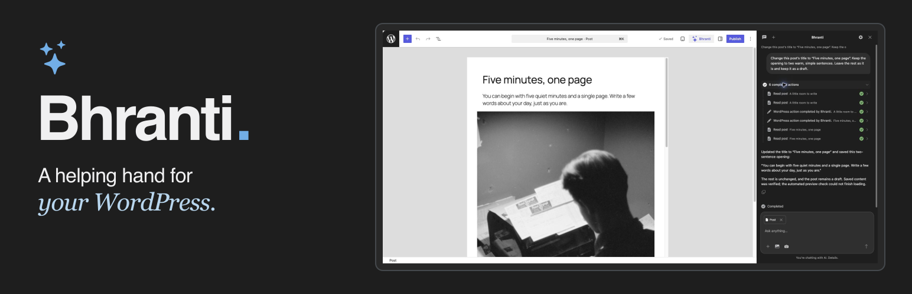
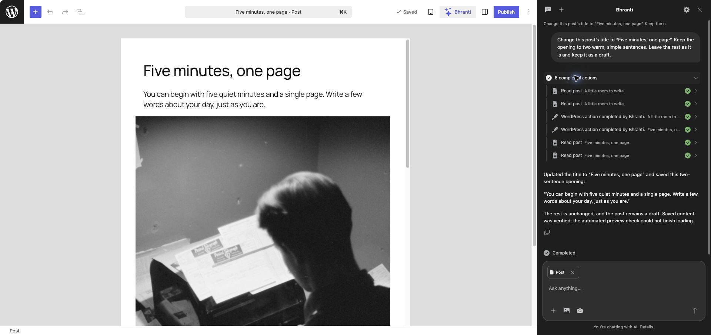
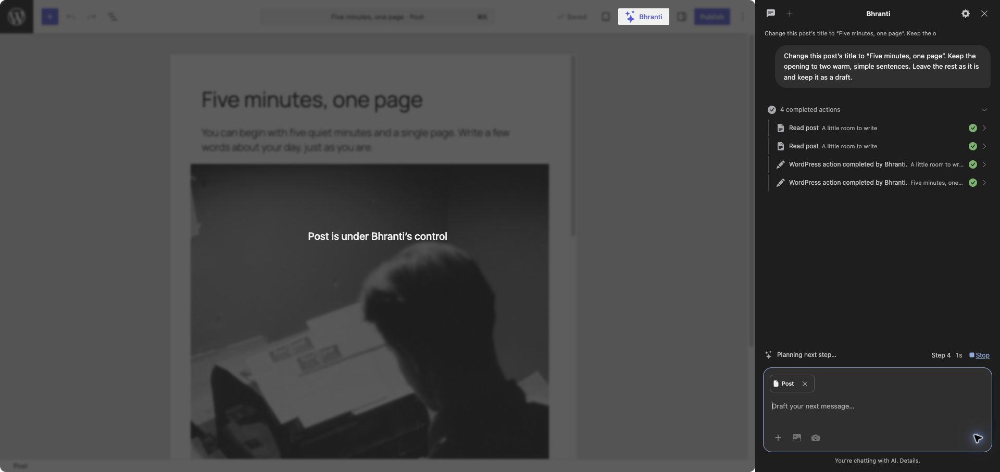
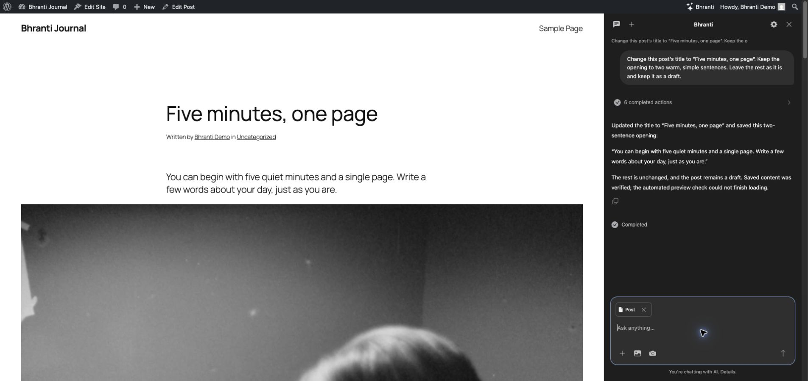

# Bhranti

An AI assistant that works alongside you in WordPress.

Ask Bhranti to update a page, improve your writing, find an image or help set up a product catalog. It reads the relevant content, makes supported changes and shows its actions in a chat beside your editor.

Requires WordPress 7.0+, PHP 8.0+ and a compatible AI text connection in **Settings → Connectors**. Image features depend on the connector and model. AI usage may count toward your provider allowance or incur charges.

## What you can do

- Write and edit posts and pages, search existing content, and recover wording from saved revisions.
- Work with supported native blocks, templates, navigation and styles.
- Find Media Library assets and generate images when your AI connection supports it.
- Manage permitted WordPress.org plugins, Contact Form 7 forms and selected WooCommerce store features.
- Give Bhranti page, block or chosen image context while keeping your work visible.
- Create agents with pasted agent.md instructions, add skill.md guidance, and save preferences you explicitly ask it to remember.
- Follow longer tasks through saved work plans, background continuation and searchable activity logs.

## Screenshots

Edit a post beside Bhranti and review its saved changes and action history.

Follow Bhranti's actions while the editor is protected from accidental edits.

Preview the updated draft on your site while keeping the conversation open.

## Get started

1. Install the Bhranti plugin ZIP through **Plugins → Add New Plugin → Upload Plugin**, then activate it.
2. Connect a compatible text provider in **Settings → Connectors**. Complete any native connector approval.
3. Review the action switches in **Bhranti → Settings**.
4. Open Bhranti from the admin bar or block editor toolbar and describe what you want to do.

Bhranti works through your existing administrator account; it does not create another WordPress user. Optional integrations need their respective plugins. For source checkouts, create the installable ZIP with `./build.sh`; GitHub's source archive is not the release package.

## Your site, your controls

Choose the actions Bhranti may take. Review an **Approve/Cancel** card before a plugin installation, later status change or uninstall. One installation approval can include activation when the card lists it; otherwise the plugin stays inactive. Supported deletion also needs approval. Cancelling stops the current task. Permanent plugin uninstall is disabled by default.

Actions and Undo run as your WordPress account, with your current permissions and Bhranti's action switches. Logs show who requested each action; raw records retain who performed it.

Supported changes can be rolled back for seven days if no conflicting edits have happened. Some actions have no automatic Undo, including plugin installation/uninstall, generated media and newly created forms. Emails and other plugin side effects cannot always be reversed. Bhranti does not edit core, theme or plugin source code, or change accounts, roles or credentials.

Longer tasks use WordPress scheduling, which needs site traffic or a configured scheduler. They pause for missing input and approvals. Browser-based page checks wait for an open browser, and automated accessibility checks do not certify full WCAG conformance.

## AI and privacy

Bhranti uses WordPress's built-in AI Client and native connectors. Configure your provider there; do not paste credentials into chat. Recognizable credentials are checked before storage and AI requests, but text checks cannot identify every secret or inspect screenshot pixels.

Your request, relevant site content and conversation context, selected instructions, preferences, and attachments may be sent to your configured provider. Bhranti adds no telemetry. Conversations are stored on your site and are not encrypted in the database; optional preference memory is encrypted separately in the WordPress database. WordPress data export and erasure cover Bhranti's records.

See the [AI and privacy guide](site/src/content/docs/ai-and-privacy.md) for sharing, retention and deletion details.

## Guides

- [Get started](site/src/content/docs/get-started.md)
- [Chats and attachments](site/src/content/docs/chats.md)
- [Permissions and Undo](site/src/content/docs/permissions-and-undo.md)
- [Agents and skills](site/src/content/docs/agents-and-skills.md)
- [Memory](site/src/content/docs/memory.md)
- [Logs and recovery](site/src/content/docs/logs-and-recovery.md)

The documentation website is built from these Markdown files, with a readable web page and Markdown version of each guide.

## Development

Run `./build.sh` to create the installable plugin folder, ZIP and SHA-256 checksums in `build/`. Use `./build.sh --check` for source checks without packaging, or `python3 tests/build.py` for packaging regressions.

See [build and release instructions](docs/release.md), [developer notes and verification](docs/development.md), and the [Astro website README](site/README.md). Website sources, dependencies and development tools are excluded from the installable plugin ZIP.

## Security

Report vulnerabilities privately through [GitHub vulnerability reporting](https://github.com/sumanbasuli/bhranti/security/advisories/new). See the [security policy](SECURITY.md) for reporting guidance.

## License

Copyright (C) 2026 Suman Basuli.

Bhranti is free software under the **GNU General Public License, version 2 or later**, the same license used by WordPress. You may use, share and modify it under those terms. It is distributed without warranty; see [LICENSE](LICENSE) for the complete license.

Bundled third-party libraries retain their licenses and notices:

- [Bootstrap Icons](assets/bootstrap-icons-LICENSE.txt): MIT.
- [axe-core](assets/vendor/axe-core/LICENSE): MPL-2.0, with [source information](assets/vendor/axe-core/SOURCE.json) and [third-party notices](assets/vendor/axe-core/THIRD-PARTY-NOTICES.md).
